<a href="https://github.com/Harsh031202">
  
</a>

  
  
  




<a href="https://github.com/Harsh031202/qr-generator-V2"></a>

  
  
  

<a href="https://github.com/Harsh031202/Jobbie-Autofiller"></a>

  
  

<a href="https://github.com/Harsh031202/YT-Downloadeer"></a>

  
  

<a href="https://github.com/Harsh031202/Musicaana"></a>

  
  


        
        
       


     

  
  

  
  
  

