  
  
  

  
  
  

  
  

  
  

  
  

     

          
        
              

<b>Verify credentials</b>

| Certificate | Issuer | Started | Credential ID | Link |
| --- | --- | --- | --- | --- |
| Google Cloud Gemini at Work | United Latino Students Association | Oct 2024 | `118494689` | [View](https://www.credential.net/91eb6d31-3edc-4b4c-b7c7-905c44a5413b) |
| What Is Generative AI? | LinkedIn | Sep 2024 | — | [View](https://www.linkedin.com/learning/certificates/db2fee9d43d891295d447cc5c3741ba1aa80aa0e7f6f9dda99a4eecf4b8f795b) |
| Generative AI: The Evolution of Thoughtful Online Search | LinkedIn | Oct 2024 | — | [View](https://www.linkedin.com/learning/certificates/51f200b678ba7105116048f518fdcf81b9bffe2cdbca509855316ae6c3a2de3d) |
| Introduction to Large Language Models by Google | Google | Mar 2024 | `8327516` | [View](https://www.cloudskillsboost.google/public_profiles/9d4ecc31-04ce-4f0e-ac37-a41ad2d3701d/badges/8327516?utm_medium=social&utm_source=linkedin&utm_campaign=ql-social-share) |
| ALPHA (DSA + JAVA) | Apna College | — | `666bcd071b61fcf2640b2fc7` | — |
| Python Fundamentals for Beginners | Great Learning | Nov 2024 | — | [View](https://www.mygreatlearning.com/certificate/VKKUMXXW) |
| Streamlining Your Work with Microsoft Copilot | LinkedIn | Nov 2024 | — | [View](https://www.linkedin.com/learning/certificates/b82224f70b610518ea6557d55908b5d691e7acb2fc203004b64d938a4d89babf) |
| Learning Microsoft 365 Copilot | LinkedIn | Nov 2024 | — | [View](https://www.linkedin.com/learning/certificates/08b501b8002547b426d490c3b51efff37043bb8ee6b15e834c74dc1a088e4975) |
| Ethics in the Age of Generative AI | Project Management Institute | Nov 2024 | — | [View](https://www.linkedin.com/learning/certificates/b0519b0a6d0620a5b6a4061806b8c095b913efedbdf03e6ac52305d6f07b05ce?trk=share_certificate) |
| Introduction to Artificial Intelligence | National Association of State Boards of Accountancy (NASBA) | Nov 2024 | — | [View](https://www.linkedin.com/learning/certificates/7d235107a221f58fc0bcd6cc74bfb6a12da0e23a8895d4a0c0aa693d41ca5f73?trk=share_certificate) |
| Tata Imagination Challenge 2024 (Student Track, Participation) | Unstop | Dec 2024 | `17a27a69-2dba-4e7b-8d9d-6bddcebd5015` | [View](https://unstop.com/certificate-preview/17a27a69-2dba-4e7b-8d9d-6bddcebd5015?utm_campaign=site-emails) |

       

  
  

  
  
  

